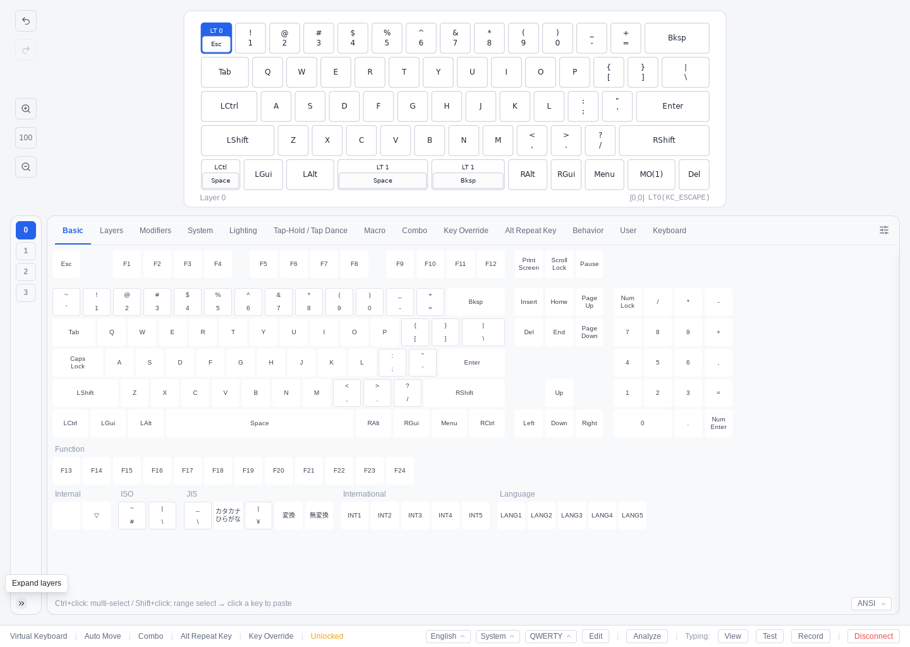

# Pipette (Keychron Edition)
<p align="center">
  
</p>

Refining the way you interact with your Vial-powered keyboards.

This is a fork of [darakuneko/pipette-desktop](https://github.com/darakuneko/pipette-desktop) that adds full support for **Keychron** and **Lemokey** keyboards: Keychron's own settings, per-key RGB, Snap Click, Hall Effect (analog) keyboards, firmware flashing, and editing over the **2.4 GHz Keychron Link** receiver. Every upstream feature is kept. See [Keychron-Specific Features](#keychron-specific-features).

It is part of the [Keychron Vial project](https://github.com/tymon3310/keychron-vial), which also has the [Keychron Vial firmware](https://github.com/tymon3310/vial-qmk) your keyboard needs and the [list of supported keyboards](https://github.com/tymon3310/keychron-vial#supported-keyboards).

Pipette is an independent keymap editor compatible with [Vial](https://get.vial.today/), built with [Tauri](https://tauri.app/).  \
Communicates with Vial keyboards via USB HID to configure keymaps, macros, lighting, and more.

[](https://pipette.tymon3310.dev)
[](https://tauri.app/)
[](https://www.rust-lang.org/)
[](https://react.dev/)
[](https://www.typescriptlang.org/)
[](https://tailwindcss.com/)
[](https://vitejs.dev/)
[](https://vitest.dev/)
[](https://webdriver.io/)
[](https://pnpm.io/)

## Table of Contents

- [Web App (Zero Install)](#web-app-zero-install)
- [Installation](#installation)
- [Migrating from 0.4](#migrating-from-04)
- [System Requirements](#system-requirements)
- [Usage](#usage)
- [Updating](#updating)
- [Operation Guide](#operation-guide)
- [Platform Setup](#platform-setup)
  - [Linux](#linux)
  - [macOS](#macos)
- [Features](#features)
- [Keychron-Specific Features](#keychron-specific-features)
- [Development](#development)
- [Architecture](#architecture)
- [Data & Privacy](#data--privacy)
- [Contributing](#contributing)
- [Acknowledgments](#acknowledgments)
- [License](#license)

## Screenshot

<p align="center">
  
</p>

### Keychron Edition

The Keychron fork adds Keychron's own settings to the keymap editor — here the **Keychron Settings** panel with debounce, NKRO, report rate and wireless power management. See [Keychron-Specific Features](#keychron-specific-features) for everything else.

<p align="center">
  
</p>

## Web App (Zero Install)

Use Pipette directly in any Chromium-based browser (Chrome, Edge, Brave, Opera, Arc) — they have the WebHID and WebUSB APIs it needs; Firefox and Safari do not:

👉 **[Launch Pipette Web (https://pipette.tymon3310.dev)](https://pipette.tymon3310.dev)**

- The same Keychron features as the desktop app: Keychron Settings, Snap Click (SOCD), Keychron RGB, Hall Effect, the firmware flasher (over WebUSB, no dfu-util needed) and the battery indicator.
- Works over a USB cable and over the 2.4 GHz Keychron Link receiver.
- Always the latest version; settings are kept in the browser. Cloud Sync and Pipette Hub uploads need the desktop app.

## Installation

Download the latest release for your platform:

- **Windows (x64)**  
  https://github.com/tymon3310/pipette-desktop/releases/latest/download/Pipette-win-x64.exe

- **macOS (Apple Silicon)**  
  https://github.com/tymon3310/pipette-desktop/releases/latest/download/Pipette-mac-arm64.dmg

- **macOS (Intel)**  
  https://github.com/tymon3310/pipette-desktop/releases/latest/download/Pipette-mac-x64.dmg

- **Linux (x86_64 AppImage)**  
  https://github.com/tymon3310/pipette-desktop/releases/latest/download/Pipette-linux-x86_64.AppImage

### Arch Linux (AUR)

Two AUR packages are available for Arch-based distributions:

- **[pipette-desktop-keychron-bin](https://aur.archlinux.org/packages/pipette-desktop-keychron-bin)** — the release build (recommended)
- **[pipette-desktop-keychron-git](https://aur.archlinux.org/packages/pipette-desktop-keychron-git)** — built from the latest source

```bash
yay -S pipette-desktop-keychron-bin
```

Both run on the system's WebKitGTK, install the [udev rule](#udev-rules) for you, and keep the same data folder as the AppImage. They never update themselves: update them with your AUR helper (`yay -Syu`). Install `dfu-util` to flash firmware.

### Windows installer

Run `Pipette-win-x64.exe`. Pipette is installed for your user only (no administrator rights needed), into `%LOCALAPPDATA%\Pipette` by default; the installer lets you choose another folder.

- The installer is **not code-signed**, so SmartScreen may warn about it: choose **More info › Run anyway**.
- Pipette uses the Microsoft Edge WebView2 runtime, which comes with Windows 11 and almost every Windows 10. If it is missing, the installer downloads it, so it needs a network connection.
- Uninstalling Pipette does not delete your data folder (`%APPDATA%\pipette-desktop`), even with the uninstaller's option to delete app data: that option removes only the data stored under `app.pipette.desktop`.

### macOS disk image

Open `Pipette-mac-arm64.dmg` (Apple Silicon) or `Pipette-mac-x64.dmg` (Intel) and drag **Pipette** into **Applications** (replace the old app if there is one). This fork's app is **not notarized** (it is ad-hoc signed only), so the first time, right-click Pipette in Applications and choose **Open**, or run `xattr -dr com.apple.quarantine /Applications/Pipette.app`. It needs macOS 12 or later; use `Pipette-mac-x64.dmg` on Intel Macs. Run it from Applications, not from the disk image: an app run from the disk image does not update itself (see [Updating](#updating)).

### Linux AppImage

Make the AppImage executable and run it; see [Platform Setup › Linux](#linux) for the udev rules keyboards need.

## Migrating from 0.4

Pipette 0.6 of this fork (upstream 0.5) is the same app rebuilt on Tauri; "0.4" below means the Electron versions (0.5.x of this fork). It takes the 0.4 data over in place: it opens the same data folder that 0.4 used, without copying or converting it. The sync format is unchanged, so PCs still running 0.4 keep syncing with it.

### Before you install

1. Quit Pipette 0.4 from the tray menu (**Quit**), not just the window. If a sync password change is unfinished in 0.4, finish it first.
2. Back up the data folder and the autostart entry:

| OS | Data folder | Autostart entry |
|---|---|---|
| Windows | `%APPDATA%\pipette-desktop` | `HKCU\Software\Microsoft\Windows\CurrentVersion\Run` (export with `reg export`) |
| macOS | `~/Library/Application Support/pipette-desktop` | Login item (note whether **Launch at Login** is on) |
| Linux | `~/.config/pipette-desktop` | `~/.config/autostart/pipette.desktop` |

There is no supported way back to 0.4; the backup is the safety net.

### After the first launch

- Sign in to Google again (Settings › Connect › Google Account › **Connect**) and enter your sync encryption password again. Sign-in data is now protected by the OS key store, and the files 0.4 saved are not read. Changes 0.4 had not uploaded are sent once you sign in with the same Google account.
- **Launch at Login** is taken over: when on, the autostart entry starts 0.5; when off, it is removed.
- Do not run 0.4 and 0.5 at the same time. 0.5 refuses to start while 0.4 is running; on Linux and macOS it cannot stop 0.4 from starting afterwards.

#### Windows: from 0.4

The installer uninstalls 0.4 for your user (the data folder is kept) and installs per user into `%LOCALAPPDATA%\Pipette` (`pipette.exe`). If 0.4 was installed for all users, uninstall it from **Settings › Apps** first. Taskbar pins are lost; the desktop shortcut is created only if you tick it at the end of the installer. Uninstalling 0.5 does not delete `%APPDATA%\pipette-desktop`.

#### macOS: from 0.4

Replace `Pipette.app` in Applications. On macOS 12, a login item registered by 0.4 keeps working, but turning **Launch at Login** off cannot remove it; remove it in the system settings. macOS 13 and later are not affected.

#### Linux: from 0.4

Existing udev rules keep working. If 0.4 saved its window size under GNOME Wayland, the first launch opens the window slightly taller. Proxy settings come from the `HTTPS_PROXY` / `HTTP_PROXY` / `NO_PROXY` environment variables; the GNOME proxy settings are not used.

## System Requirements

Pipette's window has a minimum size of **1280×1024**, and defaults to **1440×1024** (or larger is recommended) on first launch.

It might feel a bit large — but keyboards are wide, so this is what it takes to work with them comfortably. Sorry!

On a display whose usable work area (screen space minus the Dock, taskbar, or menu bar) is smaller than that minimum — common on smaller MacBook screens — the window is clamped to fit the visible area instead.

## Usage

### Quick Start

1.  Connect your Vial-compatible keyboard via USB.
2.  Launch Pipette.
3.  The keyboard will be detected automatically.
4.  Select a layer and start editing key assignments.

## Updating

Pipette checks for a new version shortly after it starts (after any startup notice is closed) and shows what it found: open the release page to see what changed, **Update** to download, verify and install it, **Not now**, or **Skip this version** (a newer version is still offered). Settings → About → **Check for updates** checks at any time.

- Every update is downloaded and verified with Pipette's signing key first. Pipette then saves your work and quits as usual, installs the update, and starts again as the new version.
- A pre-release (beta) gets the betas and the releases; a release gets releases only.
- If the download or the verification fails, nothing is installed and Pipette keeps running. If the install itself fails, Pipette has already quit: start it again and it shows what went wrong (if the previous version could not be put back, it also says where a copy of it was kept). You can always download the new version from the [releases page](https://github.com/tymon3310/pipette-desktop/releases) and install it over the old one; your settings and data are kept.
- **Windows:** the installer runs without questions and starts Pipette again. Pipette is installed for your user only, so no administrator rights are needed.
- **macOS:** move Pipette to Applications first: an app run from the disk image (or from a quarantined copy) does not update itself. If Pipette cannot write to the folder it is in, macOS asks for an administrator password.
- **Linux:** only the AppImage updates itself (an extracted AppImage does not). The file is replaced where it is, so it must be writable.
- **Arch Linux (AUR):** the AUR packages never update themselves; update them with your AUR helper (e.g. `yay -Syu`).
- Updates come from this fork's releases only, never from upstream Pipette.

## Operation Guide

For complete instructions with screenshots:

-   [Operation Guide](https://darakuneko.github.io/pipette-desktop/guide.html)

## Platform Setup

### Linux

#### AppImage executable

Make the AppImage executable before launching:

```bash
chmod +x Pipette-linux-x86_64.AppImage
```

The AppImage uses the static AppImage runtime, so `libfuse2` does not need to be installed.

#### Updating the AppImage

Pipette updates the AppImage itself (see [Updating](#updating)). The AppImage also embeds update information, so [AppImageUpdate](https://github.com/AppImageCommunity/AppImageUpdate) can update it in place, downloading only the changed parts.

#### udev Rules

udev rules are required to access keyboards:

```bash
sudo cp scripts/99-vial.rules /etc/udev/rules.d/
sudo udevadm control --reload-rules && sudo udevadm trigger
```

`scripts/99-vial.rules` is in this repository; the AppImage also carries a copy at `usr/lib/Pipette/udev/99-vial.rules`. Rules installed for 0.4 keep working.

#### Monitor App on Wayland (GNOME Shell extension)

The typing-view Monitor App toggle tags each minute of recording with the active application name. X11 exposes the focused window directly, but on Wayland the desktop sandboxes window focus, so Pipette falls back to a GNOME Shell extension.

To enable Monitor App on Wayland, install the **Focused Window D-Bus** GNOME Shell extension:

https://extensions.gnome.org/extension/5592/focused-window-d-bus/

Without the extension Monitor App silently records `null` for every minute on Wayland — keystroke counts still flow to the analytics, but per-app breakdowns are unavailable. Compositors other than GNOME Shell (KDE Plasma, Sway, etc.) are not currently supported; each would need its own focus-bridge implementation.

#### Distribution Policy

The **upstream** Pipette project is officially distributed only as an AppImage on Linux and does not provide distro-specific packages.

For this **Keychron fork**, we provide official AUR packages for Arch-based distributions (see above). We do not provide or document other distro-specific packages (.deb, .rpm, Flatpak, Snap, etc.) in order to keep the maintenance and support scope focused on the AppImage and AUR releases.

### macOS

#### Monitor App

The typing-view Monitor App toggle reads the name of the frontmost application, which normally works without any permission on macOS. If the application name does not appear (macOS behaviour can change between versions), allowing Pipette in **System Settings → Privacy & Security → Accessibility** may help.

#### Launch at Login on macOS 12

On macOS 13 and later, **Launch at Login** registers Pipette as a login item and removes it again when turned off. On macOS 12 Pipette does not register a login item itself: a login item that Pipette 0.4 registered keeps starting Pipette, but turning **Launch at Login** off cannot remove it. Remove it in the system settings yourself.

## Features

### Feature Availability

| Feature | No Integration | Google Account Integration |
|---|:---:|:---:|
| Keymap / macro / tap-dance / combo / key-override / alt-repeat editing | ✅ | ✅ |
| RGB lighting · QMK settings · Matrix tester | ✅ | ✅ |
| Snapshots & Favorites (local save / load) | ✅ | ✅ |
| Import / Export (`.vil` · `.pipette` · `keymap.c` · PDF) | ✅ | ✅ |
| Offline editing (`.pipette` without a keyboard) | ✅ | ✅ |
| Typing Test & Typing View | ✅ | ✅ |
| Analyze — typing analytics (heatmaps · ergonomics · bigrams · layout comparison · per-app) | ✅ | ✅ |
| Download community language / theme / key-label packs from Hub | ✅ | ✅ |
| Cloud Sync — snapshots / favorites / settings across devices | ❌ | ✅ |
| Download remote-only keyboards on demand | ❌ | ✅ |
| Sync typing analytics across devices | ❌ | ✅ |
| Share keymaps to Hub | ❌ | ✅ (Hub) |
| Share favorites (tap dance · macro · combo · …) to Hub | ❌ | ✅ (Hub) |
| Share typing analytics to Hub | ❌ | ✅ (Hub) |
| Publish your own language / theme / key-label packs | ❌ | ✅ (Hub) |

> **Pipette Hub requires a connected Google account.** Rows marked **(Hub)** need Hub connected (set a Display Name in Settings → Data) in addition to Google sign-in. Cloud Sync also needs a sync encryption password. **Downloading community packs from Hub needs no sign-in at all.**

### Keyboard Configuration

- **Keymap Editor** — Layer-based key assignment with drag & drop, auto-advance, and a searchable keycode palette with Mod Mask/Mod-Tap wrapper modes. Basic tab supports ANSI, ISO, JIS, and List views with International (INT1–5) and Language (LANG1–5) keycode groups. Reorganized key picker tabs (System, Behavior, dedicated Combo/Key Override/Alt Repeat Key tabs) with instant key selection. Keymap change history with undo/redo via toolbar buttons, keyboard shortcuts (Ctrl/Cmd+Z, Ctrl+Y/Ctrl/Cmd+Shift+Z), and popover undo/redo. Key popover includes a layer switching sidebar for quick layer navigation without closing the popover
- **Layout Editor** — Physical layout switching via slide-out panel (split backspace, bottom row variants, etc.)
- **Tap Dance** — Multi-tap key behaviors (tap, hold, double-tap, tap+hold, custom tapping term) with inline favorites
- **Combo** — Simultaneous key-press to trigger output keys; inline tile grid with detail editor modal and inline favorites
- **Key Override** — Replace key output when specific modifiers are held; inline tile grid with detail editor modal and inline favorites
- **Alternate Repeat Key** — Context-aware alternate repeat key bindings; inline tile grid with detail editor modal and inline favorites
- **Macro Editor** — Create and record macros with text, tap, hold, release, and delay actions (v1/v2 protocol) with inline favorites
- **RGB Lighting** — QMK Backlight, RGBLight, and VialRGB configuration
- **QMK Settings** — Dynamic firmware settings with boolean/integer fields
- **Matrix Tester** — Real-time key switch verification (20 ms polling)

### Data Management

- **Snapshots** — Save and restore complete keyboard states (keymap, macros, dynamic entries, QMK settings)
- **Favorites** — Inline favorites panel in every editor for saving/loading reusable configurations; not tied to a specific keyboard, so saved entries can be loaded on any compatible keyboard. Per-entry export, bulk import/export supported. Individual favorites can be uploaded to Pipette Hub
- **Data Modal** — Centralized favorite and Hub post management from the device selection screen
- **Export** — Download keymap as `.vil`, `.pipette`, `keymap.c`, PDF keymap cheat sheet, or PDF layout export (key outlines with summary pages for dynamic entries)
- **Import** — Load `.vil` files to restore keyboard state
- **Offline Editing** — Edit `.pipette` files without a physical keyboard connected; uses the embedded keyboard definition for a virtual layout

### Cloud Sync (Google Drive appDataFolder)

Sync your snapshots, favorites, and per-keyboard settings across devices via [Google Drive appDataFolder](https://developers.google.com/workspace/drive/api/guides/appdata).  \
The appDataFolder is **not** regular Google Drive storage — it is a hidden, app-specific folder that only Pipette can access. Your personal Drive files are never touched.

See [Data Guide](https://darakuneko.github.io/pipette-desktop/guide.html#data) for details on what is synced and how your data is protected.

### Pipette Hub

Upload and share your keymaps and favorite configurations on [Pipette Hub](https://pipette-hub-worker.keymaps.workers.dev), a community keymap gallery. Keyboard snapshots, tap dance, macro, combo, key override, and alt repeat key configurations can all be shared.

See [Data Guide](https://darakuneko.github.io/pipette-desktop/guide.html#data) for details on how Hub authentication works.

### Utilities

- **Typing Test** — Built-in typing test with WPM/accuracy tracking, downloadable language packs, and per-keyboard history
- **Typing View** — View-only mode displaying only the keyboard layout in a compact, resizable window with always-on-top support — ideal for overlaying on other applications
- **Multilingual UI** — Multiple languages supported via importable language packs; manage, import, and download packs from Pipette Hub in Settings → Tools → Language Packs
- **Light / Dark / System theme** with importable **Theme Packs** — download community colour schemes from Pipette Hub or author your own `.json` pack
- **Keyboard layout override** (QWERTY, Dvorak, etc.) for correct label display
- **Configurable panel side** (left / right)
- **Auto-lock timer**

## Keychron-Specific Features

This fork adds full Keychron (and Lemokey) keyboard support while keeping all of Pipette's own features. The keyboard needs the Keychron Vial firmware from [tymon3310/vial-qmk](https://github.com/tymon3310/vial-qmk); check the [supported keyboards](https://github.com/tymon3310/keychron-vial#supported-keyboards).

The Keychron buttons are in the keymap editor's footer and appear only when the connected keyboard supports them:

| Tab | Buttons |
|---|---|
| **Behavior** | *Keychron* (settings), *Snap Click (SOCD)*, *Keychron HE* (Hall Effect boards) |
| **Lighting** | *Keychron RGB* (RGB boards) |
| **System** | *Keychron Flasher* |

### Keychron Settings
- **Debounce** — Algorithm and time
- **NKRO** — Toggle N-Key Rollover (shown as adaptive when the firmware controls it)
- **Report Rate** — 125 Hz to 1000 Hz, up to 8000 Hz on 8K boards; USB and 2.4 GHz rates separately where supported
- **Wireless power management** — When the backlight turns off and when the keyboard sleeps
- **Firmware info** — Firmware version, MCU and protocol version

### Keychron RGB
- **Global RGB mode** — Effect, brightness, speed and colour
- **Per-Key RGB** — Set individual key colors
- **Mixed RGB** — Combine effects per region
- **OS Indicators** — Colour of the Caps Lock, Num Lock and Scroll Lock indicators, or turn them off

### Snap Click (SOCD)
Simultaneous Opposite Cardinal Direction resolution for **non-HE** keyboards:
- Define key pairs (e.g., A+D, W+S)
- Choose resolution mode: Last Input, First Key, Second Key, Neutral, etc.

### Analog Matrix (Hall Effect keyboards only)
- **Profiles** — Multiple named profiles with independent configurations
- **Actuation Modes** — Global, Regular, Rapid Trigger, Dynamic Keystroke (DKS), Gamepad, Toggle
- **Actuation Point** — Per-key or global, 0.1mm–4.0mm
- **Rapid Trigger** — Separate press/release sensitivity with bottom dead zone
- **SOCD** — Per-key-pair resolution (Deeper Travel Wins, Last Input Wins, Neutral, etc.)
- **Calibration** — Min/max readings and a live key travel view
- **Gamepad Mode** — Assign keys to joystick axes (X/Y/Z/Rz) or buttons

### 2.4 GHz Wireless (Keychron Link)
Edit a keyboard connected through Keychron's 2.4 GHz receiver exactly like a wired one:
1. Plug in the receiver and switch the keyboard to 2.4 GHz mode.
2. Pick the keyboard in Pipette: it is listed with **[2.4 GHz]** after its name.

Every Vial and Keychron feature works over the receiver; it is a little slower than a cable. Bluetooth is not supported — use the receiver or a cable.

### Firmware Update
- Flash Keychron firmware from inside Pipette while **keeping all Keychron settings** (debounce, RGB, Hall Effect profiles, etc.)
- The desktop app flashes through [dfu-util](https://dfu-util.sourceforge.net/), which must be installed and on `PATH` (Arch: `pacman -S dfu-util`, macOS: `brew install dfu-util`); the web app flashes over WebUSB

### Export / Import
- `.vil` and `.pipette` files also carry the RGB, Keychron and Hall Effect settings

### Reporting problems
Keychron support is tested on a **V5 Max ANSI Encoder**. If something does not work on another keyboard, please [open an issue](https://github.com/tymon3310/pipette-desktop/issues) with the keyboard model, the firmware version (shown in Keychron Settings) and, if you can, the log: `logs/pipette-0.log` in the data folder. Start Pipette with `VIAL_DEBUG_HID=1` to log every HID packet.

## Development

### Prerequisites

- Node.js 24 and pnpm (the version in `package.json`'s `packageManager`)
- Rust (the toolchain in `src-tauri/rust-toolchain.toml`, installed by rustup)
- On Linux, the libraries Tauri and hidapi build against, e.g. on Ubuntu:

  ```bash
  sudo apt-get install libwebkit2gtk-4.1-dev libayatana-appindicator3-dev librsvg2-dev libxdo-dev libssl-dev patchelf libudev-dev libdbus-1-dev
  ```

### Commands

```bash
pnpm install        # Install dependencies
pnpm dev            # Run the app with the development tools (Vite dev server + Tauri)
pnpm build          # Release build and installer for this OS (src-tauri/target/release/bundle/)
pnpm build:debug    # Debug build with the development tools, no installer (for the e2e tests)
pnpm test           # Vitest
pnpm test:watch     # Vitest (watch mode)
pnpm lint           # ESLint
pnpm typecheck      # TypeScript
pnpm format         # Prettier
pnpm test:e2e       # End-to-end tests (Linux; see below)
pnpm doc:guide      # Rebuild docs/guide.html from the Markdown docs
```

The Rust backend is a Cargo workspace in `src-tauri/`:

```bash
cd src-tauri
cargo test --workspace --features pipette-app/dev-tools
cargo clippy --workspace --all-targets --features pipette-app/dev-tools -- -D warnings
cargo fmt --all
```

### Web Edition (`pipette-web` / `vial-web v2`)

Pipette can also run directly in modern Chromium-based web browsers (Chrome, Edge, Brave, Opera) using the WebHID API. It is built from the same renderer with `src/web/` in place of the Tauri backend:

```bash
pnpm dev:web     # Start Vite dev server for Web
pnpm build:web   # Build static web assets into dist-web/
pnpm preview:web # Preview production web build locally
```

The end-to-end tests (`e2e-tauri/`) drive the `pnpm build:debug` app through [tauri-driver](https://crates.io/crates/tauri-driver) and WebKitWebDriver, so they run on Linux only. They use a virtual keyboard and a temporary data folder, never your own; run them under Xvfb with a session bus of their own:

```bash
pnpm build:debug
xvfb-run --auto-servernum --server-args="-screen 0 1920x1200x24" dbus-run-session -- pnpm test:e2e
```

The release builds (signed macOS app, AppImage repacked with `scripts/repack-appimage.sh`) are made by the release workflow in `.github/workflows/`.

## Architecture

Pipette is a [Tauri 2](https://tauri.app/) app: a Rust backend and a React UI in the OS WebView (WebView2 on Windows, WebKit on macOS, WebKitGTK on Linux).

```
src-tauri/          Rust backend: the app crate (src/: Tauri commands, windows, tray,
                    quit sequence, updater) and the library crates (crates/: HID,
                    VIA/Vial virtual keyboard, stores, cloud sync, Google auth,
                    Drive, Hub, typing analytics, OS key store, autostart, ...)
src/tauri-shim/     The `window.vialAPI` the UI calls, on top of the Tauri commands;
                    the VIA/Vial protocol (protocol.ts) over the HID transport
src/renderer/       React 19 UI (Tailwind CSS v4, i18next)
src/shared/         Types, constants, keycodes, KLE parser shared by the UI and shim
```

USB HID I/O runs in the backend (hidapi). The UI calls `window.vialAPI`; the shim turns each call into a Tauri command, and the commands the window may use are listed in `src-tauri/capabilities/` and `src-tauri/permissions/`.

## Data & Privacy

See the [Data Guide](https://darakuneko.github.io/pipette-desktop/guide.html) for a complete guide on what data Pipette stores, how cloud sync works, and the security measures in place for external services.

## Contributing

Contributions are welcome! In particular:

- **Translations** — Create a language pack `.json` (use the built-in English pack as a template — export it from Settings → Tools → Language Packs) and share it on [Pipette Hub](https://pipette-hub-worker.keymaps.workers.dev) or submit a PR.
  See the [Operation Guide](https://darakuneko.github.io/pipette-desktop/guide.html) §6.3 for the pack format and management workflow.
- **Theme packs** — Design a colour theme `.json` and share it on Pipette Hub.
  See the [Theme Pack Authoring Guide](https://darakuneko.github.io/pipette-desktop/guide.html#theme) for the full colour token reference and design tips.
- **Keyboard layout composite labels** — `KeyboardLayoutDef.compositeLabels` in `src/renderer/data/keyboard-layouts.ts`
  lets a layout override the label of an individual composite keycode (e.g. `LALT(KC_L)` → "Cmd L" on macOS).
  Add the full qmkId → display string mapping to the relevant layout. Reviewers must check that the
  same label is not assigned to two different composite qmkIds within one layout (label collision).
- **Bug reports & feature requests** — Open an issue to let us know.

## Acknowledgments

Pipette is built upon the foundation laid by [Vial](https://get.vial.today/) and [Vial GUI](https://github.com/vial-kb/vial-gui).
The VIA/Vial protocol implementation, keyboard definition format, and overall design philosophy originate from these projects.
We are deeply grateful to the Vial team and contributors for making open-source keyboard configuration accessible to everyone.

The Typing Test feature is based on [Monkeytype](https://github.com/monkeytypegame/monkeytype) (GPL-3.0).
Thank you to the Monkeytype team for their excellent open-source typing test.

Typing Test sentence packs are curated from the [Tatoeba Project](https://tatoeba.org) and its contributors.
Most language packs are licensed under [CC BY 2.0 FR](https://creativecommons.org/licenses/by/2.0/fr/); some packs are dedicated to the public domain under [CC0 1.0](https://creativecommons.org/publicdomain/zero/1.0/).
Thank you to the Tatoeba community for building an open corpus of example sentences.

The Aozora Bunko catalog lets you type public-domain Japanese literature. Catalog metadata (titles, authors)
is derived from the official index of [Aozora Bunko](https://www.aozora.gr.jp/) and provided via Pipette Hub; work texts
are downloaded directly from Aozora Bunko, with Aozora's ruby and editorial annotation markup cleaned during import.
Thank you to the Aozora Bunko volunteers for decades of careful digitization.

## License

[GPL-3.0-or-later](LICENSE)
